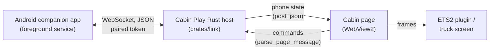

# Phone in the cab: implementation plan

> Status: first slice plus contacts and call state built and verified, uncommitted. The Rust side, the cabin
> Phone app and the Android companion are in place; the companion's debug APK builds and passes Android lint.
> This file is the working plan for bringing a real Android phone into Cabin Play's screen.

## Goal

A real Android phone can pair with Cabin Play and, inside the cab, show and act on:

- notifications (including dismissing and, where the notification allows it, replying);
- contacts, recents and caller ID;
- incoming/outgoing call state, with answer/end controls;
- SMS/MMS reading and sending (later);
- battery and signal (later);
- optionally, the phone's media session (later).

The phone stays the source of truth. Cabin Play keeps the data on the PC, on the local network, and never
sends it to a server of its own.

## What is possible, and what is not

| Feature | Android API | Notes |
|---|---|---|
| Notifications | `NotificationListenerService` | Needs the user to grant Notification access |
| Contacts | `ContactsContract` | Runtime `READ_CONTACTS` |
| Call state / caller ID | `TelephonyManager`, `CallLog.Calls` | `READ_PHONE_STATE`, `READ_CALL_LOG` |
| Dial | `Intent.ACTION_CALL` / `ACTION_DIAL` | `CALL_PHONE`; `ACTION_DIAL` needs no permission |
| Answer / end | `TelecomManager` | `ANSWER_PHONE_CALLS`; OEMs differ; full control needs default-dialer role |
| SMS read / send | SMS content provider, `SmsManager` | Full support needs default-SMS role; sideload distribution |
| Native call audio | — | **Not available to third-party apps.** Android blocks call-audio capture/injection |
| iOS | — | No notification listener, contacts or SMS access for third-party apps: Android-only feature |

The hard limit is call audio. The cab can ring, show who is calling, and dial/answer/end, but the voice
stays on the phone (speaker, headset, or a Bluetooth hands-free link to the PC). True in-cab voice needs
either Windows Bluetooth HFP routing or a separate VoIP implementation — both out of scope for the first
release.

## Architecture



- **PC hosts, phone connects.** The Rust host listens on the LAN and shows a pairing QR/token in the
  Phone app. The phone companion scans/enters it once, stores the token and reconnects on the same Wi-Fi.
- **The page never talks to the LAN directly.** The cabin page is served from the
  `https://westplay.cabin/` virtual host, so a direct `fetch`/WebSocket to `http://<phone>` would be
  mixed content and CORS-blocked. Networking lives in the Rust host and is relayed through the existing
  `post_json` / `parse_page_message` bridge, as Spotify and YouTube already are.
- **One paired phone at a time.** Pairing token, private-network source check, and a clear unpair. TLS
  with a pinned certificate (or Noise) is the next transport step; the first slice is token-gated.
- **No cloud.** Discovery and pairing are local. No accounts, no relay, no telemetry.
- **Foreground service.** The companion keeps the link alive with a persistent notification and
  reconnects with backoff. It should idle when the PC says Cabin Play is not running.

## Protocol (version 1)

WebSocket text frames, JSON. The client connects to `ws://<host>:<port>/phone?token=<token>` and sends:

```json
{"type":"hello","protocol":1,"token":"<token>","device":{"name":"Pixel 8","model":"Pixel 8","appVersion":"2.1.4","battery":87,"charging":true}}
```

Host → phone:

```json
{"type":"command","id":12,"command":{"action":"dismiss","id":"com.app|123|1700000000"}}
{"type":"command","id":13,"command":{"action":"action","id":"com.app|123|1700000000","index":0}}
{"type":"command","id":14,"command":{"action":"dial","number":"+441234567890"}}
```

Commands: `sync`, `dismiss`, `action`, `dial`, `answer`, `end`, `sms`, `reply`. `action` presses one of the notification's
own buttons by its `actions` index; a button marked `reply` is opened as a text field on the cab instead.

Phone → host:

```json
{"type":"notifications","notifications":[...]}
{"type":"notification","notification":{...}}
{"type":"notificationRemoved","id":"..."}
{"type":"contacts","contacts":[...]}
{"type":"recents","recents":[...]}
{"type":"call","call":{"id":"...","state":"ringing","number":"...","name":"...","startedAt":1700000000}}
{"type":"battery","level":87,"charging":true}
{"type":"ack","id":12,"ok":true}
```

Host → page (full snapshot, easiest to replay after a reload):

```json
{"type":"phone","state":{
  "connected":true,
  "device":{"name":"Pixel 8","appVersion":"2.1.4","battery":87,"charging":true},
  "notifications":[...],
  "contacts":[...],
  "call":null
}}
```

Page → host:

```json
{"type":"phone","command":{"action":"sync"}}
{"type":"phone","command":{"action":"dismiss","id":"..."}}
{"type":"phone","command":{"action":"action","id":"...","index":0}}
{"type":"phone","command":{"action":"answer"}}
```

## Implementation checklist

### Phase 1 — transport and notifications (built, TLS still open)

- [x] Plan extracted to this file.
- [x] `crates/link`: LAN WebSocket server, pairing token/URI, typed protocol, event queue, end-to-end
      pairing/notification/command tests.
- [x] Host relay: drain link events, keep a snapshot, post it to the cabin page, accept commands.
- [x] Cabin Phone app: connection state, notification list, dismiss, notification buttons and inline replies,
      call banner with answer/end.
- [x] Pairing card in the companion's Setup — the address, the code and a copy button — so the link's
      token is never on the truck's screen (the cabin app only points at that window).
- [x] Android companion: foreground service, notification listener, WebSocket client, pairing screen,
      contacts sync and call-state monitoring with best-effort answer/end.
- [x] Android debug APK builds with the checked-in Gradle wrapper (`lintDebug` and `assembleDebug`).
- [x] Contact search in the cabin app, with tap-to-dial.
- [x] Notification recovery: the cab waits for the host's `welcome` before showing Live; the phone keeps the
      link alive across network changes and reboots (foreground service, boot receiver, network callback, Quick
      Settings tile).
- [ ] TLS / certificate pinning (transport is token-gated only for now).
- [x] Pairing QR code, drawn in the companion's Setup (the phone scans the `cabinplay://pair` line).
- [x] Unpair in the companion's Setup: a new token, kept for the next launch, and the phone connected then let go.
- [ ] Recents/dialer and SMS UI.
- [ ] Call audio (Bluetooth HFP or VoIP) — separate project.

### Phase 2 — contacts, dialer and recents

- [x] `READ_CONTACTS` sync and contact search in the Phone app.
- [x] Tap a contact to dial (opens the phone's dialer, which recent Android may restrict in the background).
- [ ] Incremental contact sync by `ContactsContract` version.
- [x] A search among the recents.
- [x] Phone app tabs: Notifications, Recents, Contacts, Keypad (type a number, Call dials it).
- [x] Call log sync (`CallLog.Calls`, the newest 60, with the name Android caches for the number); tap a
      recent to dial it back.
- [x] Caller ID on the ringing banner from the dialer's own notification (the link's call message still carries no
      number on Android 12+, where the telephony callback doesn't provide it).
- [x] Per-app notification mute and contact favourites, kept on the cab's PC.

### Phase 3 — SMS and replies

- Default-SMS role or sideload-only reduced mode.
- Thread list and conversation view; send via `SmsManager`.
- [x] Notification replies via `RemoteInput` (`action` buttons on the cab, typed reply back to the phone).

### Phase 4 — polish and distribution

- [x] QR pairing and unpair (both in the companion's Setup).
- [x] Battery optimization guidance, OEM quirks, reconnection UX.
- [x] APK built alongside the installer; privacy note; notification-content lock (hide title and text while
      driving).
- [x] Pairing QR carries the PC's address and code, and the README documents the Windows Firewall check.
      mDNS discovery is deliberately not added: it would announce a tokenless service on the LAN for a step the
      QR already removes.
- [ ] mDNS/Bonjour discovery, if typing or scanning the address proves to be a real problem.
- TLS with pinning, replay protection, single-device enforcement.

## Troubleshooting

- If the phone can't reach the PC, confirm both are on the same Wi-Fi and allow Cabin Play through **Windows
  Firewall** on **private** networks. The phone connects out to the address in the QR/pairing line; the PC does
  not need a port-forward.
- A VPN or a guest Wi-Fi network that isolates clients will block the link even when the address is right.
- The transport is still `ws://` and token-gated, not TLS; use it on a trusted home network only.

## Repo map

- `crates/link/` — protocol and LAN server (`westplay-link`).
- `crates/host/src/phone.rs` — snapshot, relay and message shapes.
- `crates/host/src/lib.rs` — event drain, `PageMessage::Phone`, reload replay.
- `ui/src/shared/host.ts` — phone types, `HostMessage` and `PageMessage` variants.
- `ui/src/cabin/apps/phone/` — Phone app and its store.
- `ui/src/cabin/state/store.ts` — routes `phone` host messages.
- `ui/src/cabin/state/strings.ts` — Phone app words (en/tr/es).
- `android/` — companion app (Kotlin, not part of the Rust workspace).

## Known constraints

- Google Play restricts Call Log/SMS permissions to default handlers. Ship the APK beside the installer
  (F-Droid/self-hosted), not through Play.
- Android 13+ sideloaded apps must allow "Restricted settings" before Notification access can be granted.
- Foreground-service types and battery optimization differ by OEM; test on Samsung/Xiaomi/Pixel.
- Notification content can be sensitive: add a "hide content while driving" switch before release.
- No native call audio; see above.
